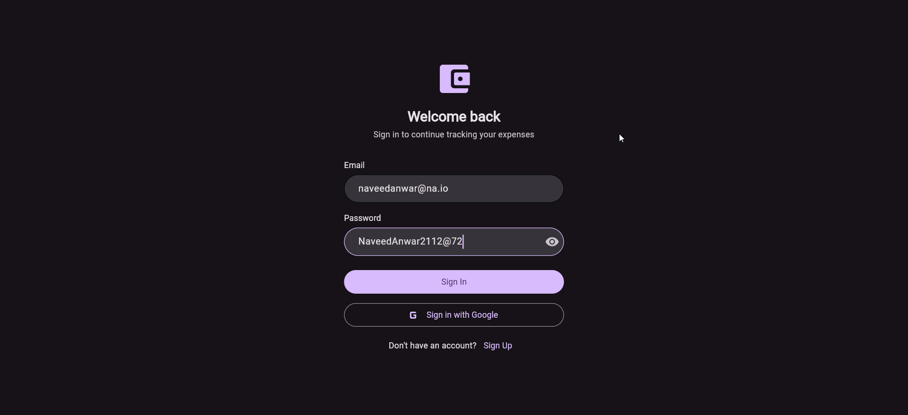
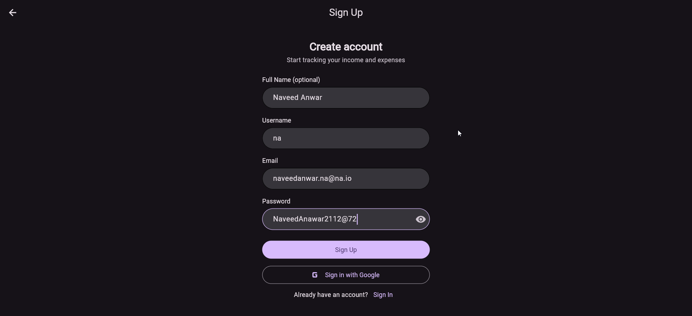
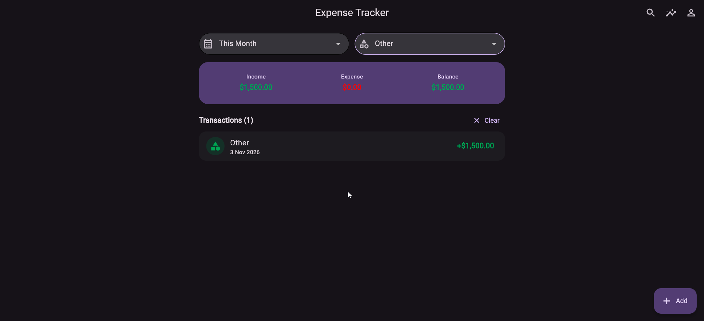
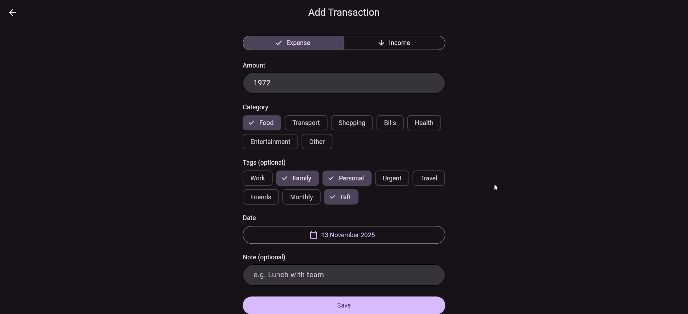
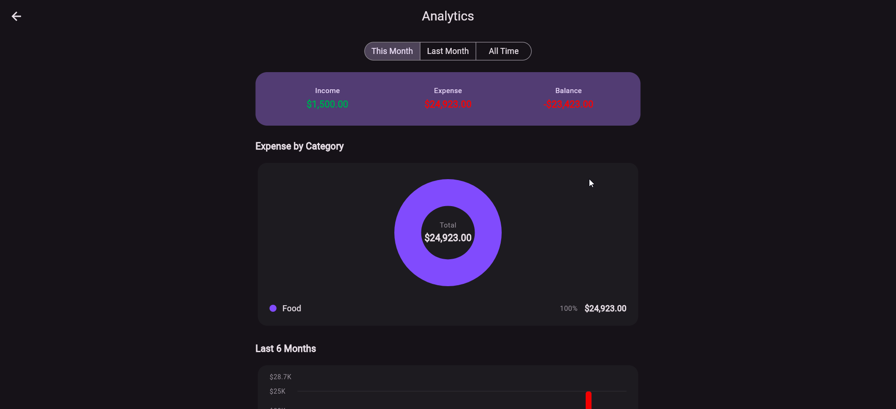
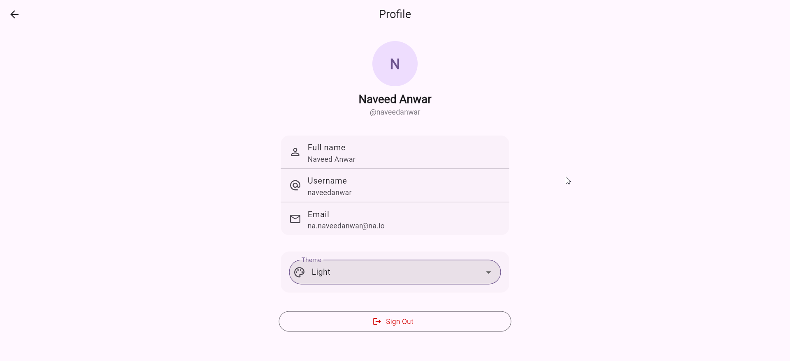
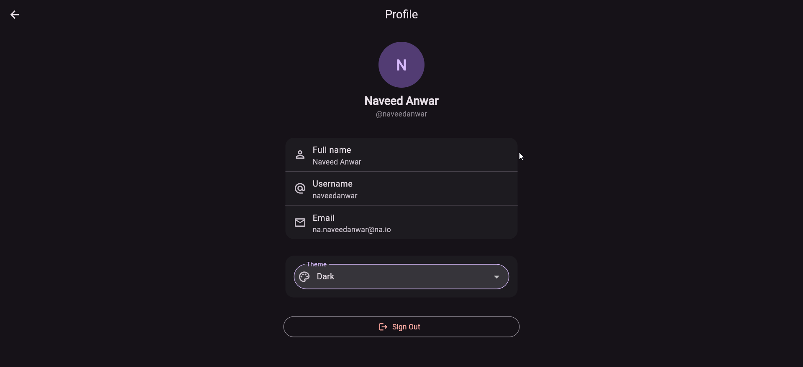

# Expense Tracker by NA — Cross-Platform (Web · Android · iOS)

A personal expense tracking application built with **Flutter** and **Firebase** — runs on **Web, Android, and iOS**. Track income and expenses, categorize transactions with tags, and visualize spending habits — with real-time cloud sync and light/dark theme.

---

## Features

- **Authentication** — Email/password sign up, login, and logout (Firebase Auth)
- **Unique usernames** — Claimed atomically via Firestore transaction (collision + rollback safe)
- **Add / Edit / Delete** — Full CRUD for income and expense transactions
- **Categories** — Expense: Food, Transport, Shopping, Bills... / Income: Salary, Freelance...
- **Tags** — Predefined multi-select tags (Work, Family, Urgent...) on every transaction
- **Search & Filters** — Search notes/tags/categories + period and category filters
- **Real-time Sync** — Data syncs instantly across devices via Cloud Firestore streams
- **Summary Dashboard** — Balance / income / expense overview card
- **Analytics** — Period filter (This Month / Last Month / All Time), category **pie chart**, 6-month income vs expense **bar chart** (fl_chart)
- **Theme** — Light / Dark / follow **System** (manual dropdown, persisted)
- **Responsive** — content width capped and centered on web/desktop, edge-to-edge on mobile
- **Clean Architecture** — presentation → domain ← data layering with repository contracts
- **Riverpod** — AsyncNotifier controllers, derived providers, DI roots (no singletons in services)

---

## Tech Stack

| Layer | Technology |
| --- | --- |
| Framework | Flutter + Dart |
| Platforms | Web · Android · iOS |
| Authentication | Firebase Auth (email/password) |
| Database | Cloud Firestore |
| State Management | **Riverpod** (`flutter_riverpod` v3) |
| Charts | `fl_chart` |
| Formatting | `intl` (date & currency) |
| Preferences | `shared_preferences` (theme persistence) |

---

## Project Structure

```
lib/
├── main.dart                    # ProviderScope + Firebase.initializeApp
├── app.dart                     # ConsumerWidget: MaterialApp + routes + themeMode
├── core/
│   ├── providers/               # firebaseAuthProvider, firestoreProvider (DI roots)
│   ├── routes/app_routes.dart   # Named routes registry
│   ├── theme/                   # AppTheme (light/dark), AppColors, themeModeProvider
│   ├── constants/               # ExpenseCategories, TransactionTags, periods
│   └── widgets/                 # ResponsiveConstrained (max-width helper)
└── features/
    ├── auth/
    │   ├── domain/              # UserProfile entity, AuthRepository contract, AuthException
    │   ├── data/                # AuthService (Firebase impl)
    │   └── presentation/
    │       ├── providers/       # authRepository, authState, profile providers
    │       ├── controllers/     # SignInController, SignUpController (AsyncNotifier)
    │       ├── screens/         # AuthGate, SignIn, SignUp
    │       └── widgets/         # AuthTextField, GoogleSignInButton (UI only)
    └── expenses/
        ├── domain/              # Transaction entity, ExpenseRepository contract
        ├── data/                # TransactionModel (serialization), ExpenseService
        └── presentation/
            ├── providers/       # repository, transactions stream, filters, analytics
            ├── controllers/     # TransactionController (add/update/delete)
            ├── screens/         # Home, AddEdit (/add), Analytics, Profile
            └── widgets/         # SummaryCard, TransactionTile, charts, chips
```

**Dependency rule:** `presentation → domain ← data` (domain never imports data).

---

## Firebase Data Model

```
users/{uid}
  ├── fullName?    # optional
  ├── username     # unique
  ├── email
  └── createdAt

usernames/{username}      # uniqueness claim (create-only)
  └── uid

users/{uid}/transactions/{id}
  ├── type         # "income" | "expense"
  ├── amount       # double (always positive)
  ├── category     # e.g. "Food", "Salary"
  ├── note?        # optional description
  ├── tags         # array of strings, e.g. ["Work", "Family"]
  ├── date         # timestamp (transaction date)
  └── createdAt    # timestamp
```

## Screens

1. **Auth** — Sign in (`/sign-in`) / Sign up (`/sign-up`) + Google button (UI placeholder)
2. **Home** (`/home`) — Summary card, search & filters (+ one-tap clear), transaction list (swipe to delete), FAB add, analytics + profile entry
3. **Add / Edit** (`/add`) — Income/Expense toggle, amount, category chips, tag chips, date picker, note
4. **Analytics** (`/analytics`) — Period segmented, summary, category pie chart, 6-month bar chart
5. **Profile** (`/profile`) — User info, theme dropdown (System/Light/Dark), sign out

---

## Setup

### 1. Install dependencies

```bash
flutter pub add firebase_core firebase_auth cloud_firestore flutter_riverpod fl_chart intl shared_preferences
```

### 2. Configure Firebase

```bash
dart pub global activate flutterfire_cli
flutterfire configure
```

> This generates `firebase_options.dart` and registers the app with your Firebase project.

### 3. Enable Firebase services

- **Authentication** → Sign-in method → *Email/Password* → Enable
- **Cloud Firestore** → Create database → paste the security rules from above

### 4. Run the app

```bash
flutter run -d chrome
```

---

## Screenshots

| Screen | Screenshot |
| --- | --- |
| Sign In |  |
| Sign Up |  |
| Home (list + filters) |  |
| Add transaction |  |
| Analytics (charts) |  |
| Profile + theme |  |
| Dark mode |  |

---

## Roadmap

| Phase | Task | Status |
| --- | --- | --- |
| Phase 1 | Firebase setup + Authentication (Riverpod auth state) | ✅ Complete |
| Phase 2 | Expense/Income CRUD with Firestore streams + theme (light/dark/system) | ✅ Complete |
| Phase 3 | Analytics with fl_chart (period filter, pie + bar charts) | ✅ Complete |
| Phase 3.5 | Tags (predefined multi-select) | ✅ Complete |
| Phase 4 | Search, list filters, one-tap clear, responsive layout, rounded menus | ✅ Complete |
